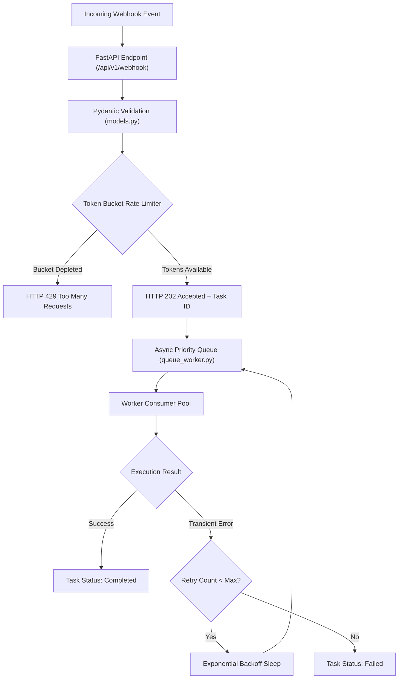

# FastAPI Async Automation Engine

An asynchronous automation engine built on FastAPI, Pydantic, token bucket rate limiting, and prioritized background task queues with exponential backoff retries.

Author: Kunal Tayde  
GitHub: [kunaltaydetayde7552-ship-it](https://github.com/kunaltaydetayde7552-ship-it)  
Contact: kunaltaydetayde7552@gmail.com  
License: MIT  

---

## Technical Problem Solved

Modern SaaS systems experience high-volume webhook bursts from payment gateways, e-commerce storefronts, and marketing automation tools. Synchronous HTTP request handlers quickly exhaust worker threads, drop incoming events, or trigger rate-limit blocks from external APIs.

This engine provides a resilient solution. Incoming webhooks are validated against strict Pydantic schemas, evaluated through a token bucket rate limiter to prevent flooding, and enqueued into an asynchronous priority queue. A background worker pool executes tasks in order of urgency (Priority 1 to 5), applying exponential backoff retry cycles on transient network failures.

---

## Architecture



---

## Repository Structure

```
fastapi-async-automation-engine/
├── .env.example              # Environment variables template
├── .gitignore                # Git ignore patterns
├── README.md                 # Technical documentation
├── requirements.txt          # Python dependencies
├── src/
│   ├── __init__.py           # Package marker
│   ├── app.py                # FastAPI routes and CLI demo orchestrator
│   ├── models.py             # Pydantic schemas (WebhookPayload, TaskResult, Health)
│   ├── queue_worker.py       # Async priority queue with retry backoff
│   └── rate_limiter.py       # Thread-safe token bucket rate limiter
└── tests/
    ├── __init__.py           # Test package marker
    └── test_main.py          # Complete unittest test suite
```

---

## Features

- **Pydantic Data Validation**: Strict validation for all incoming webhook payloads, preventing malformed data from entering downstream queues.
- **Token Bucket Rate Limiting**: Asynchronous, thread-safe token bucket limiter controlling request concurrency and preventing bursts from exhausting memory.
- **Priority Task Queues**: Discrete priority tiers (1 = Urgent to 5 = Low). Critical events such as payments or order cancellations jump ahead of routine telemetry syncs.
- **Exponential Backoff Retries**: Transient API failures or network timeouts trigger automated retry cycles with configurable delay multipliers.
- **Offline CLI Demo Mode**: Runs a comprehensive demonstration directly from the command line without binding a local network port or requiring external cloud infrastructure.

---

## Quickstart

### 1. Requirements

- Python 3.10+
- Installed packages: `fastapi`, `pydantic`, `uvicorn`, `httpx`

### 2. Setup

```bash
git clone https://github.com/kunaltaydetayde7552-ship-it/fastapi-async-automation-engine.git
cd fastapi-async-automation-engine
pip install -r requirements.txt
```

### 3. Run the Deterministic Offline Demo

```bash
python src/app.py --cli
```

### 4. Run the Unit Test Suite

```bash
python -m unittest discover -s tests -v
```

### 5. Launch the Production ASGI Server

```bash
python src/app.py --serve --host 127.0.0.1 --port 8000
```

---

## Real CLI Execution Output

Captured directly from running `python src/app.py --cli`:

```
===========================================================================
FASTAPI ASYNC AUTOMATION ENGINE
Deterministic Offline Demonstration Mode (--cli)
Author: Kunal Tayde (kunaltaydetayde7552-ship-it)
===========================================================================

[Phase 1] Simulating Burst Webhook Ingestion (Capacity: 5 tokens):
  [ACCEPTED 202] Event EVT-101 (Priority 1) -> Task task_6a1811320667
  [ACCEPTED 202] Event EVT-102 (Priority 2) -> Task task_ef0ed448b927
  [ACCEPTED 202] Event EVT-103 (Priority 5) -> Task task_7346d6ff02d4
  [ACCEPTED 202] Event EVT-104 (Priority 1) -> Task task_6c4a2520792e
  [ACCEPTED 202] Event EVT-105 (Priority 3) -> Task task_48f72e6cdfb9
  [THROTTLED 429] Event EVT-106 -> Token bucket exhausted!
  [THROTTLED 429] Event EVT-107 -> Token bucket exhausted!
  [THROTTLED 429] Event EVT-108 -> Token bucket exhausted!
  [THROTTLED 429] Event EVT-109 -> Token bucket exhausted!
  [THROTTLED 429] Event EVT-110 -> Token bucket exhausted!

Burst Summary: 5 accepted, 5 throttled.

[Phase 2] Waiting for token bucket refill (1.0s @ 5.0 tokens/sec)...
  Token bucket refilled: 5.0 available tokens.

[Phase 3] Resubmitting previously throttled events:
  [ACCEPTED 202] Event EVT-106 (Priority 4) -> Task task_e38a318b545c
  [ACCEPTED 202] Event EVT-107 (Priority 2) -> Task task_add870e1f598
  [ACCEPTED 202] Event EVT-108 (Priority 5) -> Task task_3fec6791ade9
  [ACCEPTED 202] Event EVT-109 (Priority 3) -> Task task_219900d4efd0
  [ACCEPTED 202] Event EVT-110 (Priority 1) -> Task task_a0ab1ac2265c

[Phase 4] Processing tasks through Async Priority Consumer with Retries...

[Phase 5] Final Task Execution Telemetry Table:
  Task ID          Event ID   Status       Retries  Latency (ms)   Notes
  ---------------------------------------------------------------------------
  task_6a1811320667 EVT-101    completed    0        11.40          Clean run
  task_ef0ed448b927 EVT-102    completed    0        15.85          Clean run
  task_7346d6ff02d4 EVT-103    completed    0        16.29          Clean run
  task_6c4a2520792e EVT-104    completed    2        13.09          Recovered after 2 retries
  task_48f72e6cdfb9 EVT-105    completed    0        16.38          Clean run
  task_e38a318b545c EVT-106    completed    0        14.82          Clean run
  task_add870e1f598 EVT-107    completed    0        13.62          Clean run
  task_3fec6791ade9 EVT-108    completed    0        15.41          Clean run
  task_219900d4efd0 EVT-109    completed    0        15.59          Clean run
  task_a0ab1ac2265c EVT-110    completed    0        12.15          Clean run

===========================================================================
DEMO COMPLETED: 10 completed, 0 failed, 100% processed.
===========================================================================
```

---

## API Endpoints

| Method | Path | Status | Description |
| :--- | :--- | :--- | :--- |
| `GET` | `/health` | `200 OK` | Service uptime, queued task counts, and health status |
| `POST` | `/api/v1/webhook` | `202 Accepted` | Ingests and validates event payload, enforces rate limits |
| `GET` | `/api/v1/tasks/{task_id}` | `200 OK` | Returns real-time execution status and retry counters |
| `GET` | `/api/v1/metrics` | `200 OK` | Aggregate throughput, average latency, and retry metrics |
